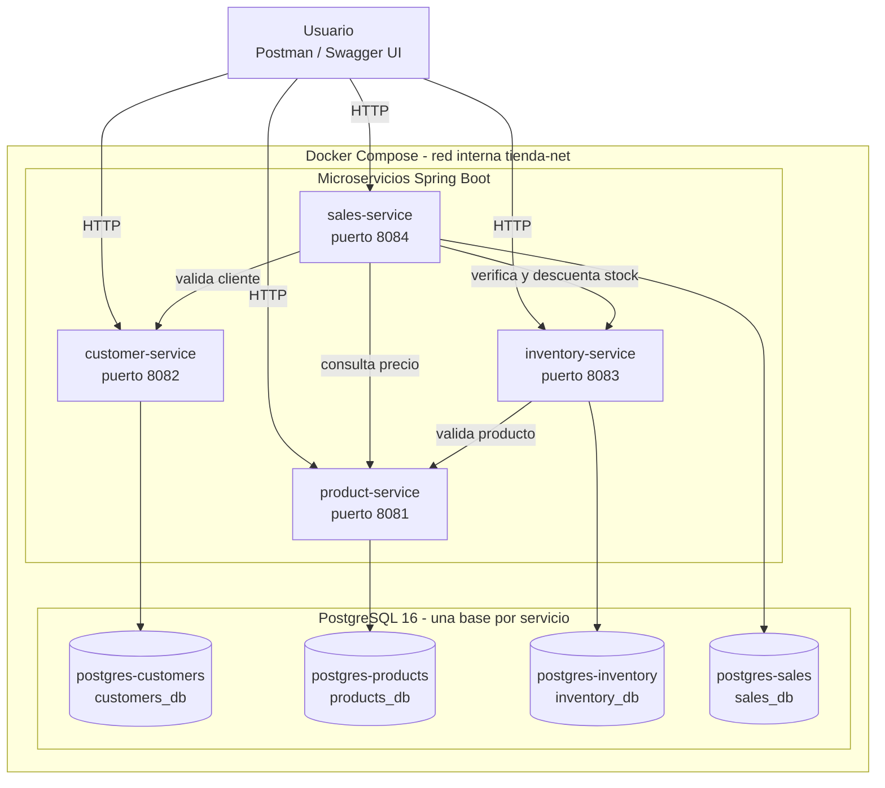

# Tienda de Mascotas: sistema de gestión con microservicios

Proyecto 6 de Programación II. Sistema que automatiza la gestión comercial de una tienda de mascotas (productos, clientes, inventario y ventas) con una arquitectura de microservicios en Java y Spring Boot. Cada servicio tiene su propia base de datos PostgreSQL, los servicios se comunican por APIs REST y todo se despliega con Docker Compose.

## Arquitectura



El flujo de una venta, el modelo de datos y la secuencia de fases del proyecto están en [docs/arquitectura.md](docs/arquitectura.md).

## Microservicios

| Servicio | Puerto | Base de datos | Responsabilidad | Swagger UI |
|---|---|---|---|---|
| product-service | 8081 | products_db | Catálogo de productos | http://localhost:8081/swagger-ui/index.html |
| customer-service | 8082 | customers_db | Registro de clientes | http://localhost:8082/swagger-ui/index.html |
| inventory-service | 8083 | inventory_db | Existencias y movimientos de stock | http://localhost:8083/swagger-ui/index.html |
| sales-service | 8084 | sales_db | Ventas y detalle de ventas | http://localhost:8084/swagger-ui/index.html |

## Tecnologías

| Componente | Versión |
|---|---|
| Java (Eclipse Temurin) | 17 |
| Spring Boot | 4.1.2 |
| Maven | 3.9 o superior (probado con 3.10.0) |
| PostgreSQL | 16 |
| Documentación de API | springdoc-openapi 3.0.3 (Swagger UI) |
| Pruebas | JUnit 5 y Mockito |
| Contenedores | Docker y Docker Compose |

## Inicio rápido

Requisitos: Docker Desktop abierto (con el motor en ejecución) y Git.

```bash
git clone https://github.com/DiegoAlex21/tienda-mascotas.git
cd tienda-mascotas
docker compose up -d --build
docker compose ps
```

La primera vez tarda varios minutos porque construye las 4 imágenes. Al terminar deben aparecer 8 contenedores en estado `running`: 4 bases de datos y 4 servicios. Para apagar todo conservando los datos:

```bash
docker compose down
```

Los pasos detallados, las variables de entorno y la solución de problemas están en el [manual de despliegue](docs/manual-despliegue.docx).

## Probar el flujo completo

1. Importe la colección `postman/Tienda-Mascotas.postman_collection.json` en Postman.
2. Con las bases de datos vacías, ejecute en orden: crear producto, crear cliente, crear inventario y registrar venta. Cada una responde `201 Created`.
3. Consulte `GET http://localhost:8083/inventory/1`: el stock disminuyó con la venta.

Cuerpo de la venta (el cliente y el producto deben existir):

```json
{
  "customerId": 1,
  "items": [
    { "productId": 1, "cantidad": 2 }
  ]
}
```

Los cuerpos de las demás peticiones están en la sección 7.3 del [manual de despliegue](docs/manual-despliegue.docx).

## Endpoints principales

| Servicio | Endpoints |
|---|---|
| product-service | `POST /products`, `GET /products`, `GET /products/{id}`, `PUT /products/{id}`, `DELETE /products/{id}` |
| customer-service | `POST /customers`, `GET /customers`, `GET /customers/{id}`, `PUT /customers/{id}`, `DELETE /customers/{id}` |
| inventory-service | `POST /inventory`, `GET /inventory`, `GET /inventory/{productId}`, `GET /inventory/{productId}/movements`, `PUT /inventory/{id}` |
| sales-service | `POST /sales`, `GET /sales`, `GET /sales/{id}`, `PUT /sales/{id}` (cancelar) |

## Reglas de negocio

- **Productos:** código de barras único, precio no negativo, nombre y categoría obligatorios.
- **Clientes:** documento y correo únicos, correo con formato válido, fecha de registro automática.
- **Inventario:** valida que el producto exista, el stock nunca queda negativo, cada cambio registra un movimiento (ENTRADA, SALIDA o AJUSTE) y se marca una alerta cuando el stock actual es menor al mínimo.
- **Ventas:** valida cliente, producto y stock, calcula subtotales y total, descuenta el inventario automáticamente y permite cancelar una venta devolviendo el stock.

## Pruebas

Pruebas unitarias con JUnit 5 y Mockito, sin necesidad de base de datos. Desde la carpeta de cada servicio:

```bash
mvn test "-Dtest=*ServiceTest"
```

Son 26 pruebas: 7 en product-service, 7 en customer-service, 6 en inventory-service y 6 en sales-service.

Pruebas de integración realizadas con Postman:

| Caso | Escenario | Resultado esperado |
|---|---|---|
| 1 | Registrar un producto (`POST /products`) | 201 Created |
| 2 | Agregar existencias (`POST /inventory`, valida contra product-service) | Producto validado e inventario registrado |
| 3 | Registrar una venta (`POST /sales`) | Cliente validado, stock verificado y venta registrada |
| 4 | Vender un producto sin existencias | 400 Bad Request |
| 5 | Consultar el historial de ventas (`GET /sales`) | Listado de ventas registradas |

## Estructura del repositorio

```
tienda-mascotas/
  product-service/      Servicio de productos (puerto 8081)
  customer-service/     Servicio de clientes (puerto 8082)
  inventory-service/    Servicio de inventario (puerto 8083)
  sales-service/        Servicio de ventas (puerto 8084)
  postman/              Colección de Postman
  docs/                 Manuales y diagramas
  docker-compose.yml    Orquestación de los 8 contenedores
  .env                  Variables de entorno del Compose
```

## Documentación

- [Manual técnico](docs/manual-tecnico.docx)
- [Manual de despliegue](docs/manual-despliegue.docx)
- [Diagramas de arquitectura](docs/arquitectura.md)
- [Colección de Postman](postman/Tienda-Mascotas.postman_collection.json)

## Video demostrativo

Pendiente: agregar aquí el enlace al video.

## Autor

Diego (GitHub: [DiegoAlex21](https://github.com/DiegoAlex21))
