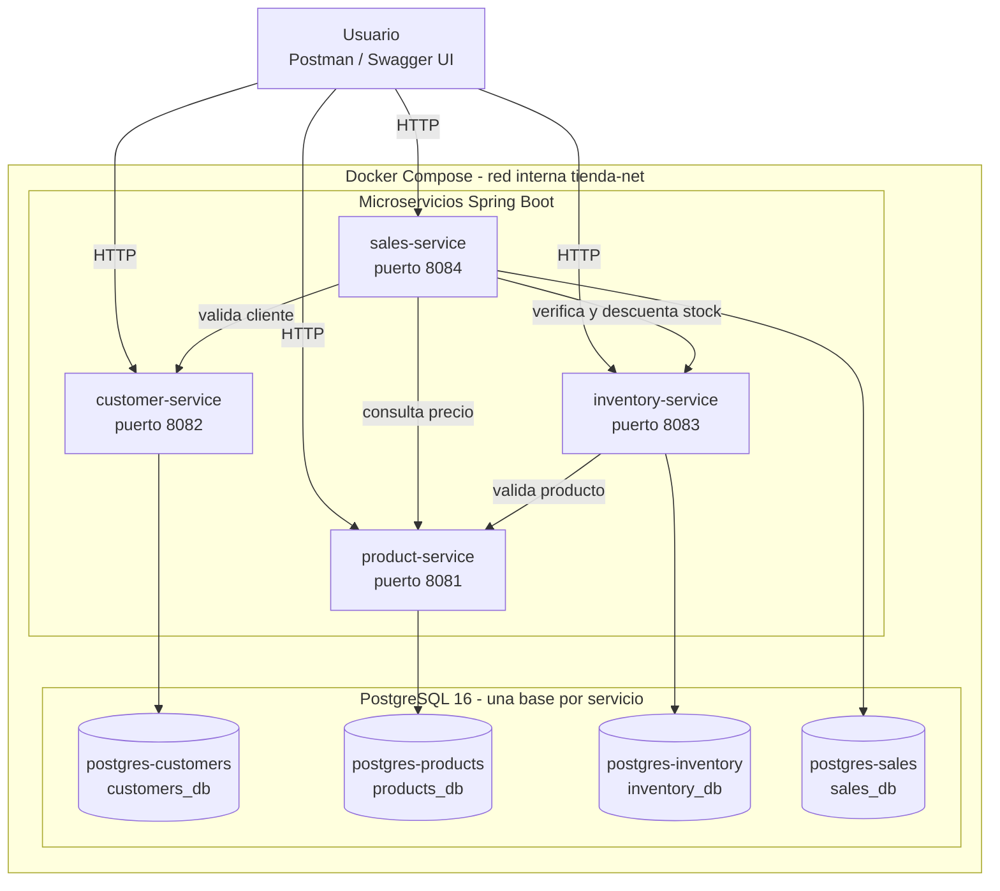
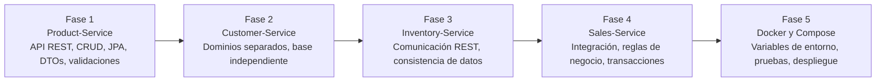
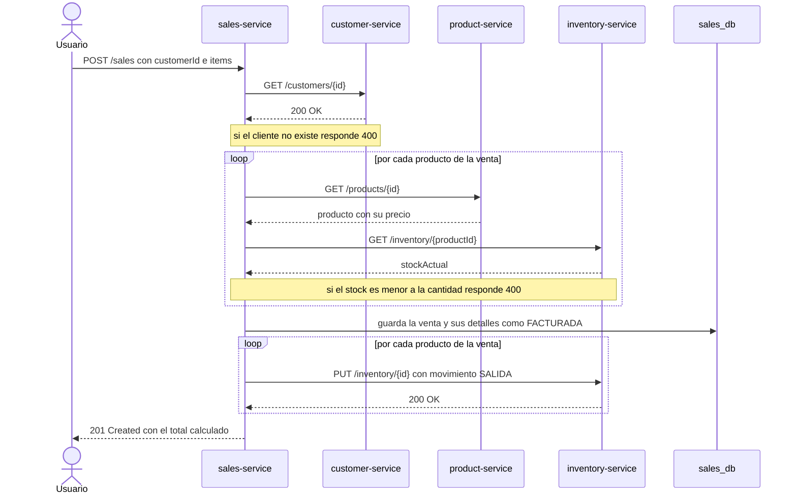
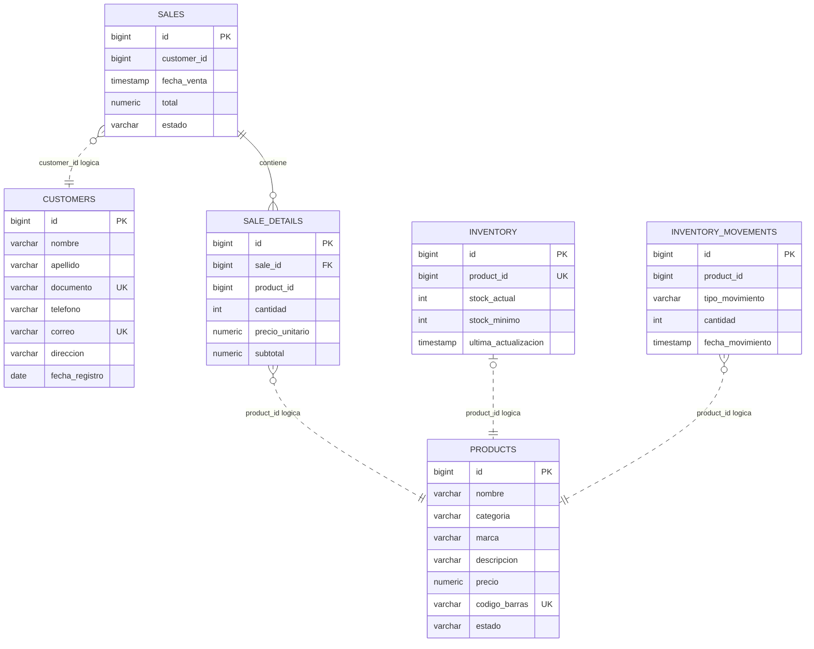

# Diagramas de arquitectura

Diagramas del sistema de gestión para tienda de mascotas, escritos en Mermaid. GitHub los dibuja automáticamente al abrir este archivo.

## 1. Arquitectura general

Cuatro microservicios Spring Boot, cada uno con su propia base de datos PostgreSQL, dentro de una red interna de Docker Compose. Las flechas entre servicios son llamadas REST.

## 2. Secuencia de aprendizaje por fases

Orden en que se construyó el proyecto y los conceptos que introduce cada fase.

## 3. Flujo de registro de una venta

Qué ocurre cuando se envía `POST /sales`. Si el cliente no existe, el producto no existe, no tiene inventario o falta stock, la venta se rechaza con 400 y no se guarda nada.

## 4. Modelo de datos

Cada base de datos es independiente. Las líneas punteadas son referencias lógicas por identificador entre servicios (validadas con llamadas REST, no con llaves foráneas). La única llave foránea real es `sale_details.sale_id`.

